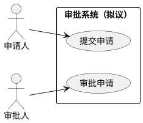
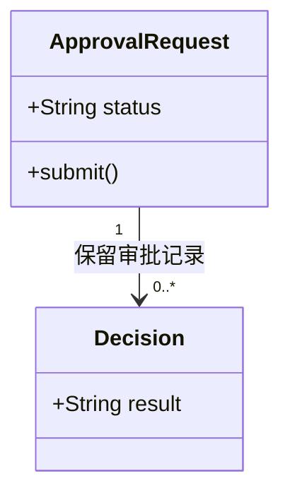
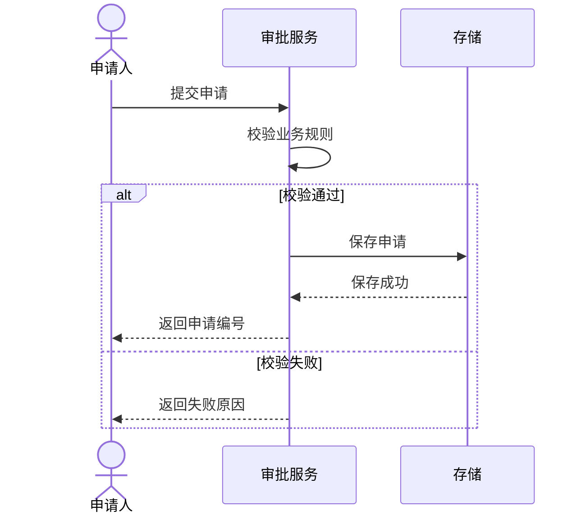
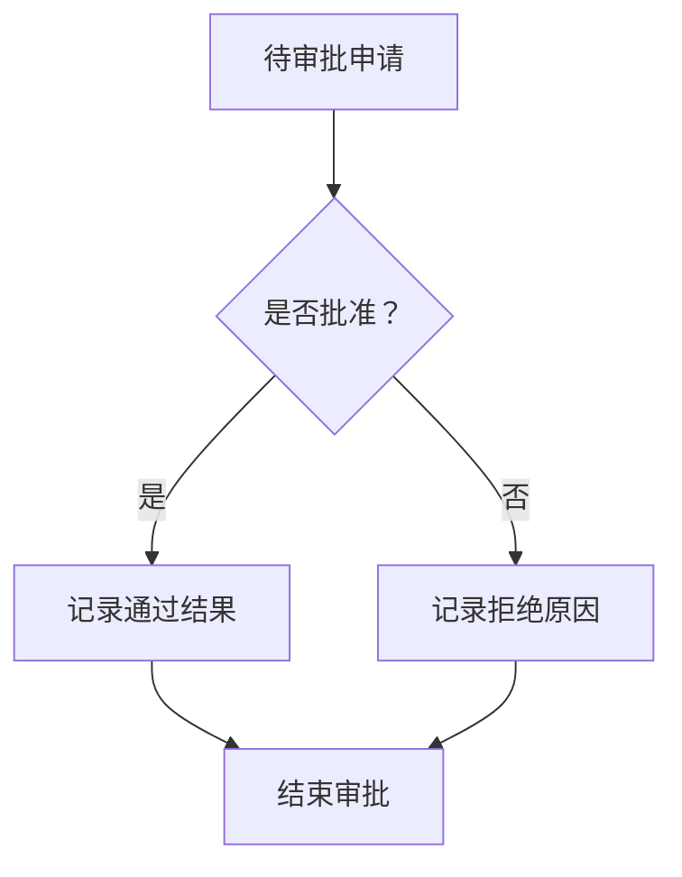
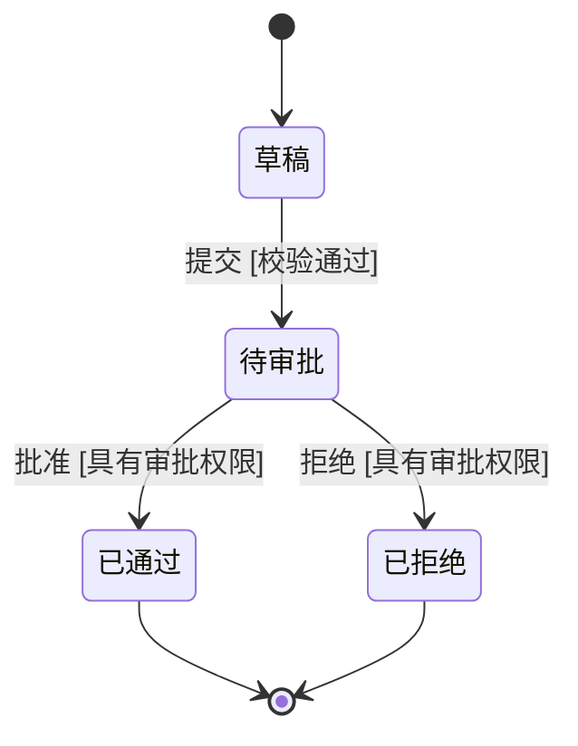

# 视图选择与表达

围绕评审问题选图，不按图种凑数量。模板指定的视图应保留；不适用时写明原因。简单改动可以只用一张图或紧凑表格。

| 需要讲清的问题 | 适用视图 | 保留的关键信息 |
| --- | --- | --- |
| 谁使用哪些能力，系统边界在哪里 | 用例图 | 参与者、业务目标、系统边界；不展示页面点击步骤 |
| 核心对象如何协作，职责归谁 | 类图 | 关键属性/方法、依赖、关联和必要的多重性；不复制全部代码 |
| 一次请求跨组件如何完成 | 时序图 | 调用方、关键消息、执行顺序、返回与关键失败分支 |
| 业务规则如何分支和汇合 | 流程图/活动图 | 起止点、判断条件、结果；并行和循环仅在实际存在时画出 |
| 一个对象允许怎样变化 | 状态图 | 状态、事件、必要的守卫条件和终态；不以操作步骤代替状态 |
| 模块边界和外部依赖如何变化 | 上下文图/组件图 | 职责边界、依赖方向、交互内容，标明新增和复用 |
| 数据关系和约束如何变化 | ER 图 | 主外键、基数、可选关系；复杂约束放相邻表格 |
| 服务在哪里运行，怎样连接 | 部署图 | 运行节点、实例关系、网络边界；仅在部署变化影响方案时使用 |

## 绘图约束

- 一图回答一个问题，紧邻对应设计段落；图题说明场景及“现状”或“拟议”。二者混合时用文字标签区分，不能仅靠颜色。
- 图中的对象、接口、状态、基数及调用顺序须有项目依据，或明确属于拟议方案。未知关系留待确认，不能为使图完整而补造。
- 保持图、正文与代码中的命名一致；现有符号使用实际名称，拟新增符号明确标记。不要把概念模型写成已经存在的代码结构。
- 只补充影响理解或评审的说明，不逐箭头复述。节点过密时按子场景拆图，避免把业务、调用、部署堆在一张图里。
- 优先沿用项目图形语言和可用渲染器。普通 Markdown 可用 Mermaid；严格 UML 用例可选 PlantUML。新或实验语法先确认目标渲染器支持。
- 只能使用 Mermaid 流程图表达参与者与能力关系时，标为“用例概览（流程图近似）”；不要冒充严格 UML 或编造图类型。模板明确要求严格 UML 时保留合适的图源，并说明渲染限制。
- 有本地渲染工具时检查语法、中文、裁切和线条；无工具时保留可编辑图源并说明未渲染验证，不宣称验证成功。不向公共渲染服务上传项目内容。

## 最小示例

下列“审批”模型只是语法示意，均属拟议方案，不作为项目事实。根据实际规则替换；无需整组复制。

### 用例：参与者与能力边界

仅在业务关系确实成立时添加 `include` / `extend`，不把操作先后画成用例关系。[PlantUML 用例语法](https://plantuml.com/use-case-diagram)

### 类：职责与对象关系

多重性需来自实际业务；仅有字段引用不足以证明组合关系。过程式项目可画模块关系，不强行引入类。[Mermaid 类图语法](https://mermaid.js.org/syntax/classDiagram.html)

### 时序：提交与校验失败

这是业务校验场景；若存储失败、异步回调、超时或重试影响本次设计，应补对应路径。仅在明确事务边界时标注事务。[Mermaid 时序图语法](https://mermaid.js.org/syntax/sequenceDiagram.html)

### 流程：审批决策

判断分支应有明确条件与结果，不能用“异常处理”掩盖重要决策。[Mermaid 流程图语法](https://mermaid.js.org/syntax/flowchart.html)

### 状态：申请生命周期

仅画允许的迁移；重入、撤回、重试及非法迁移的处理按项目规则补充。不要凭常识添加“拒绝后可重新提交”。[Mermaid 状态图语法](https://mermaid.js.org/syntax/stateDiagram.html)
