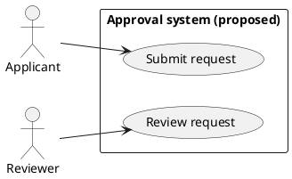
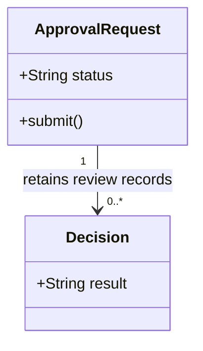
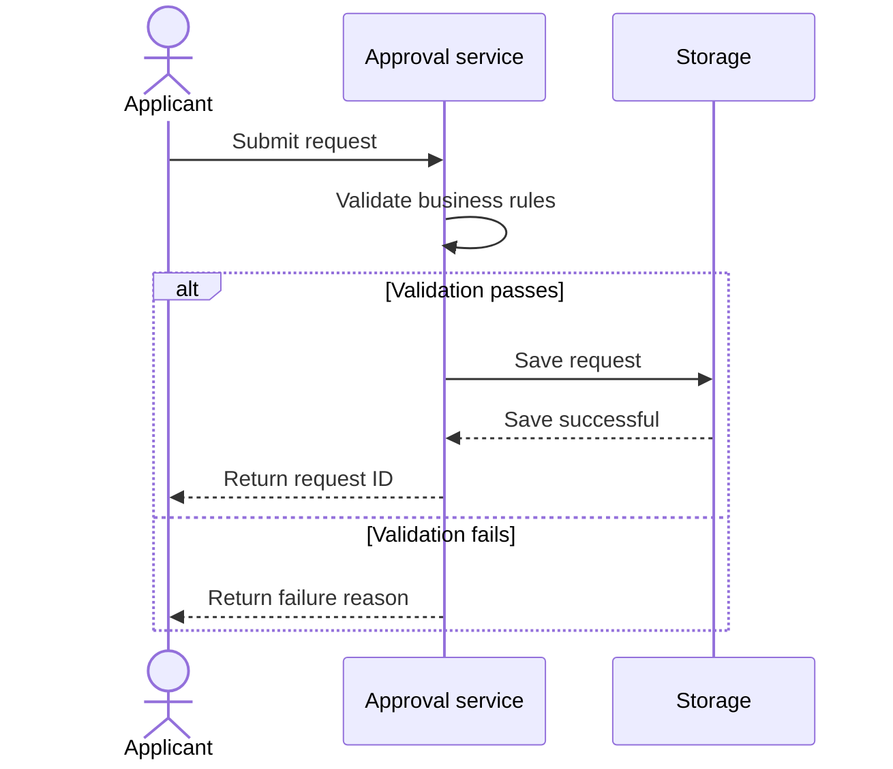
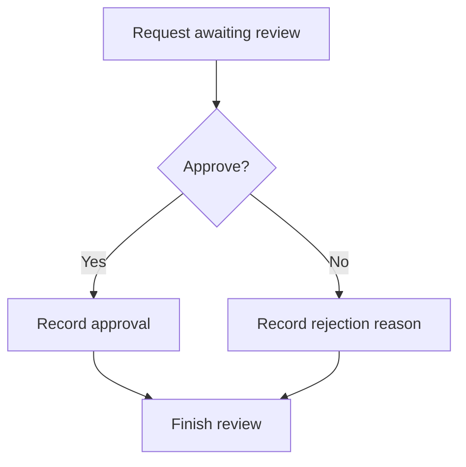
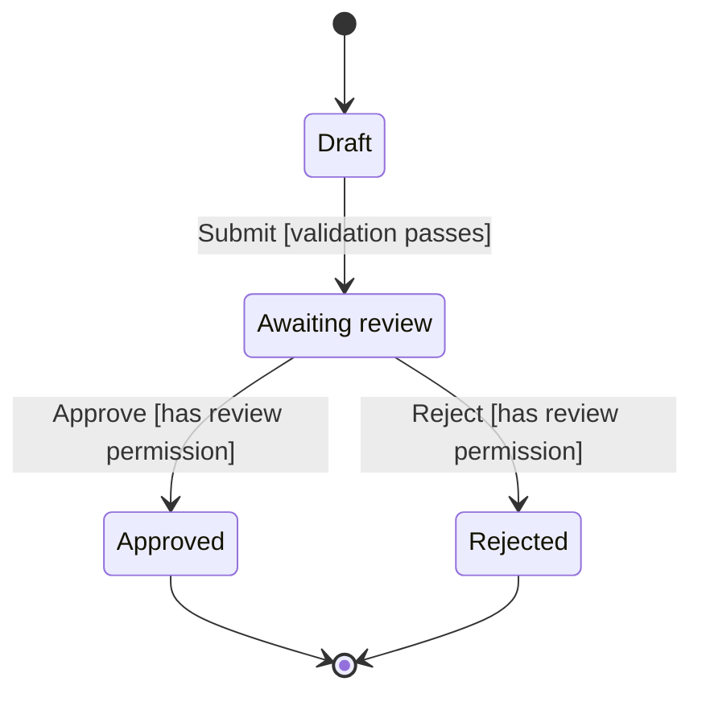

# Choosing and Presenting Diagrams

Choose diagrams around review questions, not to fill a quota of diagram types. Retain diagrams required by the template; explain why any are inapplicable. A single diagram or compact table may be enough for a simple change.

Write generated headings, prose, tables, and diagram labels in the user's output language selected by [SKILL.md](../SKILL.md). Preserve project identifiers, referenced paths, and the format of any user-specified template. The English examples below demonstrate syntax and do not require English output.

| Question to clarify | Suitable diagram | Key information to retain |
| --- | --- | --- |
| Who uses which capabilities, and where are the system boundaries? | Use case diagram | Actors, business goals, and system boundaries; omit page click sequences |
| How do core objects collaborate, and who owns each responsibility? | Class diagram | Key attributes/methods, dependencies, associations, and necessary multiplicities; do not copy all the code |
| How is a request completed across components? | Sequence diagram | Callers, key messages, execution order, returns, and key failure branches |
| How do business rules branch and converge? | Flowchart / Activity diagram | Start and end points, conditions, and outcomes; show parallelism and loops only when they actually exist |
| Which changes are allowed for an object? | State diagram | States, events, necessary guards, and final states; do not substitute procedural steps for states |
| How do module boundaries and external dependencies change? | Context / Component diagram | Responsibility boundaries, dependency direction, and interaction content; identify additions and reuse |
| How do data relationships and constraints change? | ER diagram | Primary and foreign keys, cardinalities, and optional relationships; put complex constraints in an adjacent table |
| Where do services run, and how are they connected? | Deployment diagram | Runtime nodes, instance relationships, and network boundaries; use only when deployment changes affect the design |

## Diagram Constraints

- Have each diagram answer one question and place it beside the corresponding design paragraph. Its title should identify the scenario and whether it shows the current state or a proposed design. When both appear together, distinguish them with text labels rather than color alone.
- Objects, interfaces, states, cardinalities, and call order must have project evidence or be explicitly part of the proposed design. Leave unknown relationships open for confirmation; do not invent them to make a diagram appear complete.
- Keep names consistent across diagrams, prose, and code. Use actual names for existing symbols and clearly mark proposed additions. Do not present a conceptual model as an existing code structure.
- Add only explanations that affect understanding or review, without restating every arrow. Split dense diagrams by subscenario instead of crowding business behavior, calls, and deployment into one diagram.
- Prefer the project's diagram language and available renderers. Mermaid works for ordinary Markdown; PlantUML is an option for strict UML use case diagrams. Confirm that the target renderer supports any new or experimental syntax before using it.
- When a Mermaid flowchart is the only available way to show actors and capabilities, label it "Use case overview (flowchart approximation)" in the selected output language. Do not present it as strict UML or invent a diagram type. When the template explicitly requires strict UML, retain appropriate diagram source and explain rendering limitations.
- When a local renderer is available, check syntax, text rendering in the selected output language, clipping, and lines. Otherwise, retain editable diagram source and state that rendering was not verified; do not claim successful validation. Do not upload project content to public rendering services.

## Minimal Examples

The approval models below illustrate syntax only. They are all proposed designs, not project facts. Replace them according to actual rules; there is no need to copy the entire set.

### Use Cases: Actors and Capability Boundaries

Add `include` / `extend` only when the business relationship actually exists; do not depict operation order as a use case relationship. [PlantUML use case syntax](https://plantuml.com/use-case-diagram)

### Classes: Responsibilities and Object Relationships

Multiplicities must come from actual business rules; a field reference alone does not establish composition. For procedural projects, show module relationships instead of forcing in classes. [Mermaid class diagram syntax](https://mermaid.js.org/syntax/classDiagram.html)

### Sequences: Submission and Validation Failure

This is a business validation scenario. Add corresponding paths if storage failures, asynchronous callbacks, timeouts, or retries affect the design. Annotate transactions only when their boundaries are established. [Mermaid sequence diagram syntax](https://mermaid.js.org/syntax/sequenceDiagram.html)

### Flowcharts: Approval Decisions

Decision branches need explicit conditions and outcomes; do not hide important decisions behind "error handling." [Mermaid flowchart syntax](https://mermaid.js.org/syntax/flowchart.html)

### States: Request Lifecycle

Show only allowed transitions. Add handling for reentry, withdrawal, retries, and invalid transitions according to project rules. Do not assume that a rejected request can be resubmitted. [Mermaid state diagram syntax](https://mermaid.js.org/syntax/stateDiagram.html)
